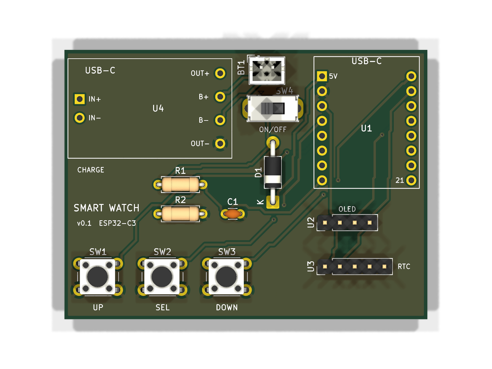

# Smart Watch v0.1 (module build)

A beginner-friendly smartwatch built from ready-made modules, hand-wired on perfboard
with 30 AWG silicone wire. No SMD soldering needed.

| File | What it is |
|---|---|
| `smart-watch.kicad_pro` | KiCad 10 project (open this) |
| `smart-watch.kicad_sch` | Schematic: every connection, part values, supplier and price fields |
| `smart-watch.kicad_sym` / `smart-watch.pretty/` | Project library: module symbols and footprints |
| `docs/smart-watch-schematic.pdf` | Printable schematic for the workbench |
| `docs/smart-watch-bom.csv` | Bill of materials exported from the schematic |
| `smart-watch.kicad_pcb` | 2-layer carrier PCB, 62 x 46 mm, all through-hole |
| `fab/smart-watch-gerbers.zip` | Gerbers + drill file, ready to upload to JLCPCB / PCBWay |
| `docs/pcb-top.png`, `docs/pcb-bottom.png` | 3D renders of the board |

## Specifications

| | |
|---|---|
| MCU | ESP32-C3 (RISC-V 160 MHz, Wi-Fi 2.4 GHz + BLE 5) on a SuperMini board |
| Display | 0.96" SSD1306 OLED, 128x64, I2C address `0x3C` |
| Timekeeping | DS3231 RTC (±2 ppm, about ±1 min/year), I2C `0x68`, own CR1220 backup cell |
| Time sync | NTP over Wi-Fi (optional) |
| Inputs | 3 tactile buttons: Up, Select, Down. Each one wakes the watch from deep sleep |
| Battery | 3.7 V LiPo, 300–500 mAh, JST-PH 2.0 lead |
| Charging | TP4056 module, USB-C, 1 A max (DW01 over-charge, over-discharge and short protection) |
| Power switch | Slide switch between the charger output and the ESP32 |
| Battery monitor | 1:2 divider on GPIO0 (ADC1) |
| Approx. size | Stack of ~35 x 30 x 15 mm before the case |

## Pin assignments (ESP32-C3 SuperMini)

| Pin | Net | Connected to | Why this pin |
|---|---|---|---|
| 5V | VSYS | D1 cathode | Battery feeds the board's onboard 3.3 V regulator |
| 3V3 | +3V3 | OLED VCC, RTC + | Regulated 3.3 V for both I2C modules |
| GND | GND | Everything's ground, TP4056 OUT- | |
| GPIO0 | BAT_ADC | R1/R2 midpoint, C1 | ADC1 channel, still works while Wi-Fi is on |
| GPIO3 | BTN_UP | SW1 to GND | Can wake from deep sleep (GPIO0–5 only) |
| GPIO4 | BTN_SELECT | SW2 to GND | Can wake from deep sleep |
| GPIO5 | BTN_DOWN | SW3 to GND | Can wake from deep sleep |
| GPIO6 | I2C_SDA | OLED SDA, RTC D | Not a strapping pin |
| GPIO7 | I2C_SCL | OLED SCL, RTC C | Not a strapping pin |
| GPIO1, GPIO10 | (spare) | | Free for a buzzer or vibration motor later |
| GPIO2, 8, 9 | (unused) | | Strapping pins; GPIO8 drives the onboard LED, GPIO9 is BOOT |
| GPIO20, 21 | (unused) | | UART RX/TX |

> Clone boards differ. Wire by the labels printed on your modules, not by pin position.
> The OLED in particular may be `VCC GND SCL SDA` instead of `GND VCC SCL SDA`.

Firmware pin map for the Arduino IDE (board: **ESP32C3 Dev Module**, USB CDC On Boot: Enabled):

```cpp
#define PIN_BAT_ADC   0
#define PIN_BTN_UP    3
#define PIN_BTN_SEL   4
#define PIN_BTN_DOWN  5
#define PIN_SDA       6
#define PIN_SCL       7
// Wire.begin(PIN_SDA, PIN_SCL);
// Buttons: pinMode(pin, INPUT_PULLUP); pressed = LOW
// Deep sleep: esp_deep_sleep_enable_gpio_wakeup((1<<3)|(1<<4)|(1<<5), ESP_GPIO_WAKEUP_GPIO_LOW);
// Battery volts = analogReadMilliVolts(PIN_BAT_ADC) * 2 / 1000.0
```

## Wiring list

| # | From | To | Net |
|---|---|---|---|
| 1 | LiPo red (+) | TP4056 B+ | BAT+ |
| 2 | LiPo black (-) | TP4056 B- | BAT- |
| 3 | TP4056 OUT+ | Slide switch middle pin | BAT_OUT |
| 4 | Slide switch outer pin | D1 anode | VSW |
| 5 | D1 cathode (band) | ESP32 5V | VSYS |
| 6 | TP4056 OUT- | ESP32 GND | GND |
| 7 | ESP32 3V3 | OLED VCC and RTC + | +3V3 |
| 8 | ESP32 GND | OLED GND and RTC - | GND |
| 9 | ESP32 GPIO6 | OLED SDA and RTC D | I2C_SDA |
| 10 | ESP32 GPIO7 | OLED SCL and RTC C | I2C_SCL |
| 11 | ESP32 GPIO3 / 4 / 5 | One leg of SW1 / SW2 / SW3 | BTN_* |
| 12 | Other leg of each button | GND | GND |
| 13 | VSW (switch outer pin) | R1 (100k) to R2 (100k) to GND | BAT_ADC at the middle |
| 14 | R1/R2 midpoint | ESP32 GPIO0, plus C1 (100nF) to GND | BAT_ADC |

Never connect B- to OUT-: the protection chip sits between them.

## PCB (optional instead of perfboard)



| | |
|---|---|
| Size | 62 x 46 mm, 2 layers, 1.6 mm FR-4 |
| Tracks | 0.4 mm wide, 0.2 mm clearance, 6 vias (0.8 mm pad / 0.4 mm drill) |
| GND | Copper pour on both layers |
| Checks | ERC 0 violations; DRC 0 violations, 0 unconnected, matches the schematic |

Layout: TP4056 top-left (USB-C on the left edge for charging), ESP32-C3 top-right (USB-C
on the top edge for programming), battery JST, power switch and D1 in between, buttons
along the bottom. The OLED's 4-pin header sits below the ESP32. Use long pins (11 mm) so
the 27 x 27 mm OLED module stacks **over** the ESP32, header at the bottom. The display is
then upside down, so call `display.setRotation(2)`. The outline is on the `Dwgs.User` layer.

To order: upload `fab/smart-watch-gerbers.zip` to JLCPCB/PCBWay with the default settings
(2 layers, 1.6 mm, HASL). This is a module carrier, bigger than a final watch: it's for
proving the circuit before squeezing it into a case.

> Before ordering, hold your modules against a 1:1 printout of the board (KiCad: File →
> Print, scale 1:1). The ESP32-C3 SuperMini row spacing (15.24 mm) and the TP4056 pad
> positions are from typical clones and may differ on yours.

## Power budget (estimate)

| State | Current | Notes |
|---|---|---|
| Deep sleep | ~0.2 mA | ESP32 ~5 µA, regulator ~40 µA, DS3231 ~110 µA, divider ~19 µA, OLED off ~10 µA |
| Screen on, Wi-Fi off | ~30–40 mA | Short glance when a button is pressed |
| Wi-Fi time sync | ~100 mA avg, 350 mA peaks | Once a day for ~10 s |
| SuperMini red power LED | +1–2 mA always | Remove it (desolder or scrape) for real battery life |

Example day with a 400 mAh cell: deep sleep 24 h (~4.8 mAh), 30 glances of 5 s (~1.5 mAh)
and one Wi-Fi sync (~0.3 mAh) comes to about 6.6 mAh/day, so **roughly 6–8 weeks per charge**
once the power LED is removed. With the LED left on, expect about 1–2 weeks.

Low-battery limit: D1 drops ~0.2–0.3 V and the board's regulator needs ~3.4 V, so the watch
can reset during Wi-Fi bursts once the cell falls below ~3.6–3.7 V. Show a "charge me"
warning at 3.7 V. A later revision could swap D1 for a P-MOSFET "ideal diode" to recover
that headroom.

## Shopping list

The electronic parts are in `docs/smart-watch-bom.csv`. You'll also need:

| Item | Approx. price (INR) |
|---|---|
| 30 AWG silicone wire, small perfboard | 50–100 |
| 20/22 mm watch strap | 150–300 |
| 3D-printed case (Thingiverse/Printables STL, printed by Robu.in or a local service) | 200–500 |
| CR1220 cell for the DS3231 mini (if not included) | 20–40 |

Total with the modules: roughly ₹1,500–2,500. Tools (if needed): soldering iron kit,
multimeter, hot glue gun, wire stripper.

Where to buy: Robu.in, Robocraze, ElectronicsComp, Probots, Evelta, Amazon.in (check reviews),
or Chenoy Trade Centre (CTC) in Secunderabad.

## Build order

1. **Breadboard:** ESP32-C3 + OLED + RTC on I2C (GPIO6/7). Show the time using the
   `Adafruit_SSD1306` and `RTClib` libraries. Power from the ESP32's USB.
2. **Buttons and sleep:** add SW1–SW3 and deep sleep, and wake on any button.
3. **Battery:** add LiPo, TP4056, slide switch, D1 and the battery divider. Check with a
   multimeter that VSYS reads about 3.5–4.0 V **before** connecting the ESP32.
4. **Final assembly:** solder everything with thin wire, insulate with Kapton tape or heat
   shrink, fit it into the case and attach the strap.

## Safety

- Never puncture, bend, crush or short-circuit the LiPo. Keep it away from the soldering iron.
- Only use a TP4056 module **with** protection (DW01 + 8205A chips next to the B+/B- pads).
- Check battery polarity with a multimeter: some JST leads are wired backwards.
- Don't charge the watch unattended or while wearing it during the first tests.
