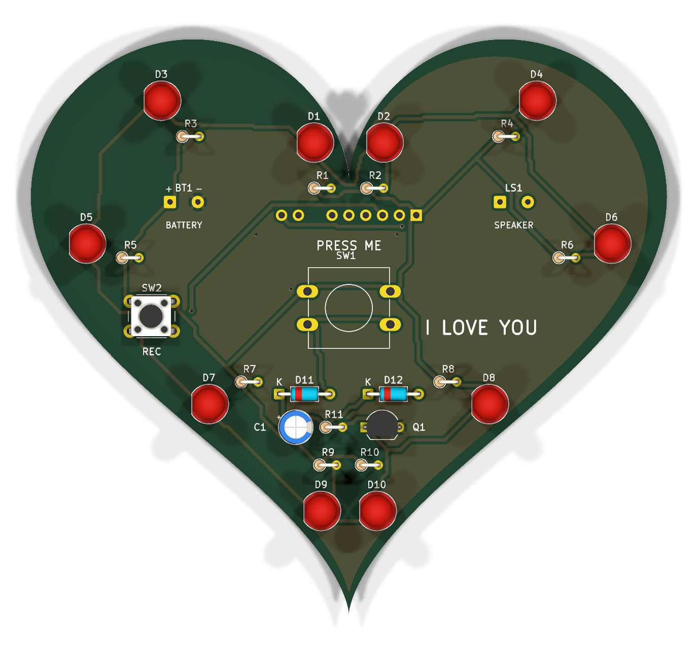

# Voice-Message Heart

A heart-shaped gift: press the big button in the middle and it plays a recorded voice
message while 10 red LEDs light up around the edge, stay on for about the length of the
message, then slowly fade out. Hold the small **REC** button to record a new message
(up to 10 s). The message stays even with the batteries removed.

| File | What it is |
|---|---|
| `voice-heart.kicad_pro` | KiCad 10 project (open this) |
| `voice-heart.kicad_sch` | Schematic, with supplier and price fields on every part |
| `voice-heart.kicad_pcb` | Heart-shaped 2-layer PCB, 96 x 86 mm, all through-hole |
| `voice-heart.kicad_sym` / `voice-heart.pretty/` | ISD1820 module symbol and footprint |
| `docs/voice-heart-schematic.pdf` | Printable schematic |
| `docs/voice-heart-bom.csv` | Parts list |
| `docs/pcb-front.png`, `docs/pcb-back.png` | 3D renders |
| `fab/voice-heart-gerbers.zip` | Upload this to the PCB maker |

## How it works

| Block | Parts | What it does |
|---|---|---|
| Power | 3x AAA box with switch and screw lid (4.5 V) | No coin cells, so nothing small and dangerous to swallow |
| Voice | ISD1820 module + 8 Ω speaker | Records from its onboard mic while REC is held, plays the whole message on a PLAY press |
| Buttons | SW1 12 mm PLAY (front centre), SW2 6 mm REC (left lobe) | Both pull the module's REC/PLAYE pins up to the battery (active HIGH) |
| Glow timer | D11, D12, C1 22 µF, R11 470k, Q1 BC517 | A press charges C1; C1 drains slowly into Q1's base, so Q1 keeps the LEDs on about 10 s, then they fade over about 15 s |
| Heart LEDs | D1–D10 red 5 mm, R1–R10 330 Ω | About 6 mA each, about 60 mA total while glowing |

Want a longer glow? Swap C1 for 47 µF (about twice as long). Shorter? Use 10 µF.

Battery life: about 0 mA when idle (and the box has its own switch), about 80 mA while
playing. Hundreds of plays per set of AAAs.

## Ordering the board

1. Upload `fab/voice-heart-gerbers.zip` to JLCPCB, PCBWay or an Indian maker such as
   Lion Circuits / PCB Power.
2. Settings: 2 layers, 1.6 mm, **solder mask: Red**, silkscreen: White, HASL, 5 pcs.
   The board is under 100 x 100 mm, so it qualifies for the cheapest tier.
3. Roughly ₹600–1,000 for 5 boards delivered to India from JLCPCB (cheaper locally).

## Parts (about ₹250–350 plus the PCB)

See `docs/voice-heart-bom.csv`. Everything is at Robu.in or CTC Secunderabad.
Ask for an **ISD1820 module** (the red board with a mic and 3 buttons), a 28–40 mm
8 Ω 0.5 W speaker, a **3x AAA box with switch and screw cover**, a BC517 Darlington
transistor, and diffused red 5 mm LEDs.

## Soldering order

Lowest parts first, so the board sits flat on the bench:

1. R1–R11 (resistors, standing upright). R11 is the 470k; the other ten are 330.
2. D11, D12 (1N4148): the black band goes on the side marked **K**.
3. Q1 (BC517): its flat face matches the silkscreen.
4. C1 (22 µF): the long leg (+) goes in the hole marked **+**.
5. D1–D10 (LEDs): the **long leg goes in the round pad**, the short leg in the square pad.
6. SW2 (REC) and SW1 (PLAY, big button).
7. Back side: solder a **female 6-pin header** onto U1's VCC…FT pads so the ISD1820
   plugs in from the back. Run two short wires from the module's speaker terminals to
   the SP+ / SP− pads next to it.
8. Speaker: two wires to the SPEAKER pads, then glue the speaker to the back.
9. Battery box: red wire to **+**, black to **−** on the BATTERY pads. Glue the box to
   the back; it also works as a stand. A dab of hot glue over each wire joint stops the
   wires breaking.
10. Trim every leg flush on the back, then cover the back with felt or a 3D-printed
    plate so there are no sharp points.

> **Check before plugging in:** the header labels on the back (VCC GND REC PLE PLL FT)
> must line up with the labels printed on your ISD1820 module. Most modules use this
> order, but clones differ.

## Recording a message

1. Switch the battery box ON.
2. Hold **REC**, wait half a second, speak clearly about 10–20 cm from the module's mic,
   and let go within 10 seconds. The heart glows while you record.
3. Press the big heart button to hear it back.

Record again any time; the new message replaces the old one.

## Safety (for an 8-year-old)

- AAA box with a **screw-shut lid**: batteries can't fall out.
- No coin cells, no LiPo, nothing gets hot (about 80 mA from 4.5 V).
- Trim the legs and cover the back so there are no sharp points.
- Speaker volume is modest, comfortable at arm's length.
